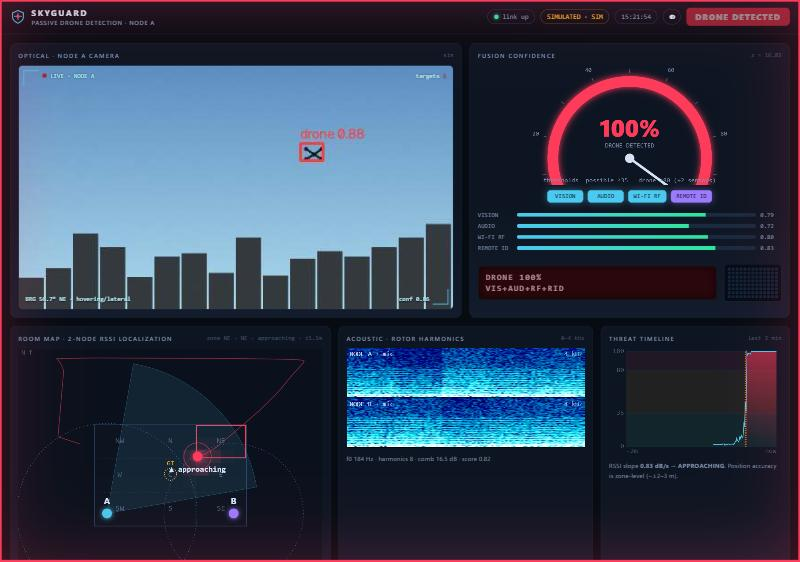
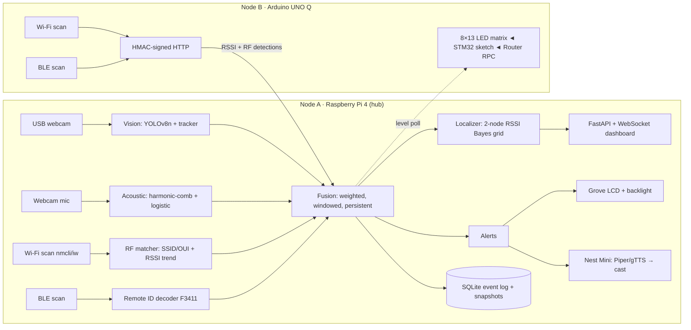

# 🛡️ SkyGuard — passive drone detection for ~$200

> hackPHS 2026 · theme **Into the Skies** · track **Best Cybersecurity**

SkyGuard hears, sees and *radio-sniffs* small drones with two cheap sensor nodes, fuses the evidence into a single
confidence score, estimates which part of the room the drone is in, and raises alerts on an LCD, an LED matrix, a
smart speaker and a live web console. **Detection only, fully passive** — it never transmits to, jams, deauthenticates or
interferes with anything.

```bash
git clone https://github.com/zaydmulani09/skyguard && cd skyguard
python -m venv .venv && . .venv/bin/activate          # Windows: .venv\Scripts\activate
pip install -r requirements.txt
python -m skyguard run                                 # → http://localhost:8000  (simulation profile, no hardware)
```
Open the dashboard and press **▶ Run demo** — a scripted drone approaches, is heard, sniffed on Wi-Fi and BLE, seen on camera, the alert fires, then it leaves.
`pytest -q` runs the 20 tests. Real hardware = change one line (`profile = "pi"`), see [HARDWARE_SETUP.md](HARDWARE_SETUP.md).



## The problem
Unauthorized drones over airports, stadiums, prisons and wildfire fire-lines are a real safety problem (a hobby drone grounds
aircraft; a single drone in a fire zone grounds firefighting helicopters). Commercial detection systems are priced for
governments — thousands to tens of thousands of dollars. Venues that need a tripwire, not a weapon, have nothing. SkyGuard is a
sub-$250 **tripwire**: it answers "is there a drone, roughly where, and are we sure?" and nothing more.

## Architecture

Every device has a **real driver and a simulated driver** (`skyguard/hal/`), chosen by `config.toml` profile
(`sim` · `laptop` · `pi` · `unoq`). The `sim` profile runs the *real* DSP, matcher, tracker, fusion and localizer on synthetic
inputs (the simulated mic synthesizes rotor audio and the real FFT pipeline detects it; the simulated Wi-Fi driver emits AP lists
and the real SSID/OUI matcher flags them). The `laptop` profile uses this machine's own webcam, mic and Wi-Fi radio as stand-ins.

## Detectors (each outputs a 0–1 score + metadata)

### 1 · Acoustic — rotor harmonics
Small multirotors radiate a tonal blade-pass fundamental `f0` (≈100–500 Hz) with strong, **steady** integer harmonics. Speech has
harmonics but its pitch glides; fans, wind and rain are broadband; music is wideband/rhythmic. On a 1 s clip `x` at 16 kHz we
compute a Welch log-power spectrum `L(f)` (4096-pt Hann, 50 % overlap) and

* **harmonic comb contrast**  `comb = max_{f0∈[80,520] Hz} ( mean_{k=1..8} L(k·f0) − mean_{k=1..8} L((k+½)·f0) )` — peaks vs the valleys between them; also `nh`, the number of harmonics standing >3 dB above their valleys;
* **pitch steadiness** `stab = 1/(1 + 10·σ(f0 over 4 sub-frames)/f0)`;
* spectral **flatness** (geometric/arithmetic mean over 100–4000 Hz), low/high **tilt**, peak-to-median **tonality**, the share of energy in 7 octave-ish **bands**, and the spectral **centroid**.

A class-balanced, L2-regularised **logistic regression** on the 15 standardised features gives `p`; the operating threshold `θ` is the lowest
one with ≤2 % false-positive rate on *training* data, and the score handed to fusion is `s = σ(10·(p − θ))` so 0.5 means "at the tuned threshold".
Inference is ~ms of NumPy FFTs — no GPU, no model file bigger than a JSON of 15 weights.

**Evaluation** — [Al-Emadi *DroneAudioDataset*](https://github.com/saraalemadi/DroneAudioDataset) (`Binary_Drone_Audio`: 1 s clips of Parrot Bebop/Mambo recordings vs
ESC-50 environmental sounds, speech, silence, noise). 2 664 clips (1 332 drone / 1 332 other), **split by source recording** so adjacent
1 s clips of one flight never straddle train and test (1 113 recordings train / 476 test; 1 892 / 772 clips):

| held-out test (772 clips) | precision | recall | false-positive rate | accuracy |
|---|---|---|---|---|
| tuned threshold θ = 0.74 | **0.966** | **0.768** | **0.025** | 0.876 |
| plain p ≥ 0.5 | 0.879 | 0.881 | 0.112 | 0.885 |

ROC AUC **0.949**. Per-clip numbers are *before* temporal smoothing: the fusion stage needs the score to repeat within 4 s, which is what
turns a 2.5 % per-second false-positive rate into **0 false alarms per hour** (below). Reproduce: `python scripts/eval_audio.py <dataset dir>`
([results/audio_eval.json](results/audio_eval.json)). Caveats: indoor Bebop/Mambo recordings are one drone family; unseen airframes
(e.g. large camera drones) and strong wind are untested.

### 2 · Vision — YOLOv8-nano + tracker
`VISION_RESULTS`

Tracking: greedy nearest-centroid association; a track must reach `min_hits = 3` before it counts (kills 1-frame false positives).
**Bearing** from a pinhole model: `θ = heading + (c_x/W − ½)·HFOV` (Logitech C-series ≈ 60–78°, set in `config.toml`).
**Motion**: box-area growth over the last 12 frames → *approaching / receding / lateral* (`ΔA/A > 8 %`). Snapshots of the annotated frame are stored on each DRONE event.

### 3 · RF Wi-Fi — passive
`nmcli dev wifi list` / `iw dev wlan0 scan` read the beacons the Wi-Fi chip already hears (no monitor mode, no injection).
Each AP is scored by the noisy-OR of an **SSID rule** and a **manufacturer-OUI** match:
`score = 1 − (1 − s_ssid)(1 − s_oui)`, with rules for `TELLO-xxxxxx` (0.97), DJI/Mavic/Spark (0.90), Parrot (0.92), Autel (0.90), toy/FPV makers (0.85),
`WIFI_UFO`/`KY-UFO` (0.70), `FPV` (0.65), `drone|quadcopter|uav` (0.60) and default `ESP_xxxxxx` (a deliberately **weak 0.30**: a smart plug alone never fires).
Locally-administered (randomised) MACs are ignored for OUI matching. The OUI table is a *partial* public list — extend `DRONE_OUIS`.
**RSSI trend**: median-smoothed RSSI per BSSID; OLS slope over ≤20 s; `> +0.35 dB/s` = approaching, `< −0.35` = leaving.

### 4 · RF Bluetooth — **bonus**: Remote ID (ASTM F3411 / FAA)
Drones sold in the US broadcast Remote ID; the Bluetooth-4/5 flavour is a BLE advertisement with service data under UUID **0xFFFA**
(`0x0D` app code, counter, 25-byte messages). `decode_remote_id` parses Basic ID (UAS ID, UA type), Location (lat/lon `int32·1e-7`, height, speed, heading) and System/Operator messages.
A decoded Remote ID is near-definitive (it is a mandated, structured broadcast), so it is the only evidence allowed to reach DRONE alone.
Tested on spec-shaped payloads built by an encoder in the test-suite; **not yet validated against a real drone's broadcast** (see Limitations).

### 5 · Two-node localization
Both nodes report RSSI of the flagged emitter. Log-distance model: `RSSI_i = P0 − 10·n·log10(d_i) + N(0,σ²)` (`P0 = −50 dBm` @1 m, `n = 2.7`; calibrate in `config.toml`).
A **Bayesian grid filter** (0.25 m cells, extending 6 m past the walls because drones arrive from outside) keeps a posterior `P(x,y)`:
*predict* = Gaussian blur (the drone moves), *update* = `P ← P · ∏_i exp(−(RSSI_i − model_i(x,y))²/2σ²)`. When the camera sees a drone, its bearing adds a Gaussian
wedge likelihood from Node A. Output: MAP/mean position, spread, 3×3 **zone** posterior, compass sector, and approaching/leaving from the RSSI slope.

**Honest accuracy** (`scripts/eval_loc.py`, 150 random room positions × 20 RSSI samples at 2 Hz, 12×8 m room, nodes on the same wall, log-normal shadowing + model mismatch):

| shadowing σ | model error (path-loss n, P0) | median error | 90th pct | exact zone (9 zones) | zone ±1 |
|---|---|---|---|---|---|
| 2 dB | calibrated | **0.82 m** | 1.4 m | **87 %** | 100 % |
| 4 dB | calibrated | 0.94 m | 1.6 m | 81 % | 100 % |
| 6 dB | calibrated | 1.15 m | 2.1 m | 73 % | 99 % |
| 4 dB | σn = 0.3, σP0 = 3 dB | 2.02 m | 5.0 m | 47 % | 90 % |
| 6 dB | σn = 0.5, σP0 = 5 dB | 2.71 m | 7.7 m | 39 % | 84 % |
| 6 dB + camera bearing | σn = 0.5, σP0 = 5 dB | 1.67 m | 6.7 m | 51 % | 94 % |

Two RSSI anchors give two circles that intersect in *two* points (a mirror image across the line joining the nodes). **Put both nodes on one wall**: the mirror solution then lands outside the room, and a mild outside-room prior picks the right one
(with nodes on opposite corners the same estimator scored 57–61 % exact-zone at best). The dominant error is *model mismatch* — walls, people and antennas shift `P0` and `n` per venue — so **calibrate `p0_dbm` and `path_loss_n`** in `config.toml` (stand 1 m from a node with a phone hotspot, then at 5 m).
This is a simulation of the algorithm, not a field measurement; the real result will be zone-level at best.

### 6 · Fusion
Per sensor *s* on node *n*, evidence is the decayed max in an 8 s window: `e[s,n] = max_i score_i · e^{−(now−t_i)/τ}`, τ = 4 s. `E_s = max_n e[s,n]`. Then a weighted log-odds sum

`z = b + Σ_s w_s·E_s + a_s·(K−1) + a_n·N_both`,  `confidence = σ(z)`

with `b = −4.2`, `w = {vision 4.2, audio 3.2, Wi-Fi 3.6, Remote ID 6.5}`, `K` = sensors with `E_s > 0.5`, `a_s = 1.6` (cross-**sensor** agreement), `N_both` = sensors seen on **both nodes** with `a_n = 0.8` (cross-**node** agreement).
Levels: **CLEAR** < 0.35 ≤ **POSSIBLE** < 0.80 ≤ **DRONE DETECTED**, with hysteresis (leave below 0.60 after ≥5 s).

**How false positives are reduced** (all enforced in code and tests):
1. *No single sensor can declare a drone* — a lone full-confidence sensor tops out near 45–50 %; DRONE needs ≥2 sensors, or a decoded Remote ID.
2. *Persistence* — a sensor counts fully only if it fires twice within 4 s (8 s for Wi-Fi scans); a one-off blip is scaled ×0.45, so independent glitches can't line up across sensors.
3. *Agreement bonuses* — corroboration across sensors and across nodes adds evidence; disagreement adds none.
4. *Look-alike discipline* — ESP default APs score 0.30 by design; randomised MACs give no vendor evidence; vision needs a 3-frame track.
5. *Hysteresis* — no flicker at the threshold.

**Replay** (`scripts/eval_fusion.py`; audio scores are the real held-out predictions above, the other sensors' rates are *stated assumptions* in the JSON — change and re-run):

| one quiet hour (3 600 s) | false alarms |
|---|---|
| audio alone, thresholded | 100 |
| vision alone (1 %/frame FP assumed) | 36 |
| Wi-Fi alone (0.3 %/scan FP assumed) | 8 |
| **SkyGuard fusion** | **0** |

and over 1 000 simulated 40 s drone events: **0 missed, median time-to-DRONE 1 s, p95 2 s**.
These are replays of modelled per-tick statistics, not field data; real-world false-alarm behaviour needs venue testing.

## Alerts and UI
* **LCD (Grove 16×2 RGB)** — `DRONE 91% NE` / `VIS+AUD+RF`; backlight green / amber / flashing red.
* **UNO Q LED matrix** — slow radar sweep when clear, scan bar when possible, flashing ⚠ on detection (STM32 sketch ← Arduino Router RPC).
* **Nest Mini** — rate-limited (30 s) spoken alert "Drone detected, north east, confidence 91 percent": Piper (offline) → gTTS → laptop speaker; WAV served over local HTTP and cast with `pychromecast`.
* **Dashboard** — live camera with boxes, rotor-harmonic waterfall, RF emitter table (flagged / weak / benign), room map with both nodes, camera FOV, RSSI rings, posterior heat-map and zone, fusion gauge, threat timeline, event log with snapshots + which sensors fired, node health (CPU/temp/mem). Dark console theme + light toggle, phone-friendly.
* **Demo mode & test buttons** — scripted event (approach → audio → RF → vision → ALERT → leave) and per-detector test buttons; both drive the full pipeline.
* **SQLite** event log (`skyguard.db`), **systemd** services for the Pi and UNO Q (`deploy/`).

## Security of SkyGuard itself
Node B → hub traffic can be **HMAC-SHA256 signed** (`INGEST_KEY`, 30 s replay window, constant-time compare) so a rogue device on the shared hotspot cannot inject fake detections or silence real ones (tested: unsigned, forged and replayed batches → 401).
Services run with `NoNewPrivileges`; no radio is ever put in monitor mode or asked to transmit.

## Passive-only / legal note
SkyGuard only **receives**: beacons that Wi-Fi chips list for every nearby network, public BLE advertisements, ambient sound and a camera image. Remote ID is *designed* to be received by anyone. It never transmits, jams, spoofs, deauthenticates or connects to a drone's network.
Jamming/disabling aircraft is illegal in most jurisdictions (e.g. 47 U.S.C. § 333, 18 U.S.C. § 32); detection is not. Point a camera/mic only where you may record. This is a hackathon prototype, not legal advice and not a certified safety system.

## Honest limitations
* **Not a field-validated system.** Audio and vision numbers come from public datasets; localization and fusion numbers from simulation of the algorithms. No numbers here come from real drones flying near the hardware.
* **Not every drone emits Wi-Fi/BLE.** Autonomous / pre-programmed drones and FPV racers on analog video or proprietary links (e.g. DJI OcuSync, ELRS) are invisible to Wi-Fi/BLE sniffing — only audio and vision see them. Remote ID covers only compliant drones.
* **Wi-Fi OUI/SSID lists are partial and trivially spoofable by an attacker who renames their drone** — fusion exists precisely so no single list is trusted.
* **Acoustic range is short** (tens of metres at best, wind/traffic degrade it); dataset is one drone family; 77 % per-second recall.
* **Vision** is fine-tuned on a small public set (mostly large, close drones); distant small drones, birds at range and sun glare are weak spots; the Pi 4 runs a 416-px nano model at a few FPS.
* **Localization** is zone-level with 2 anchors; real walls/people shift RSSI; P0/n need calibrating per venue.
* nmcli reports signal as %, converted to dBm by a rough `% /2 − 100` mapping (use `iw` for true dBm).
* UNO Q code (matrix sketch, Router RPC call, deploy script) and the Grove LCD driver are **written from documentation, untested on hardware** — see STATUS.md.

## Cost (approximate US list prices — verify)
| Part | ≈ $ |
|---|---|
| Raspberry Pi 4 (4 GB) | 55 |
| Seeed Grove Base Hat | 10 |
| Grove LCD RGB Backlight v4.0 | 15 |
| Logitech USB webcam (camera + mic) | 25 |
| Arduino UNO Q (2–4 GB) | 45–60 |
| microSD + 2 × USB power | 25 |
| **Sensing system** | **≈ $175–190** |
| Nest Mini (optional spoken alerts) | 50 |
| BENFEI USB-Ethernet (dev convenience only) | 15 |
| **Everything incl. speaker** | **≈ $240–255** |

## Repo map
```
skyguard/           core.py config+types · fusion.py · localize.py · node.py (sensor loops) · server.py (hub, FastAPI/WS, SQLite)
  detectors/        acoustic.py · vision.py · rf.py (Wi-Fi matcher, RSSI tracker, Remote ID decode)
  hal/              sim.py (world + simulated drivers) · real.py (webcam, ALSA/PortAudio mic, nmcli/iw/netsh, bleak, Grove LCD, UNO Q matrix, Nest)
web/index.html      the whole dashboard (no build step)
deploy/             pi.sh · unoq.sh · systemd units        unoq_app/  LED-matrix sketch
scripts/            eval_audio · eval_loc · eval_fusion · train_vision · nest_discover
tests/              fusion · localization · RF matcher · Remote ID · acoustic · hub end-to-end · signed ingest
```
Docs: [HARDWARE_SETUP.md](HARDWARE_SETUP.md) · [DEMO.md](DEMO.md) (2-minute judge script) · [DEVPOST.md](DEVPOST.md) · [STATUS.md](STATUS.md)

## Credits & licences
Code: MIT. Audio evaluation data: Al-Emadi et al., *DroneAudioDataset* (academic/educational licence; not redistributed here). Vision weights fine-tuned from Ultralytics YOLOv8n (AGPL-3.0) on the public Kaggle *drone-dataset-uav* (dasmehdixtr) mirrored on Hugging Face (`kc34251/Drone-Detection`); respect those licences if you reuse the weights.
